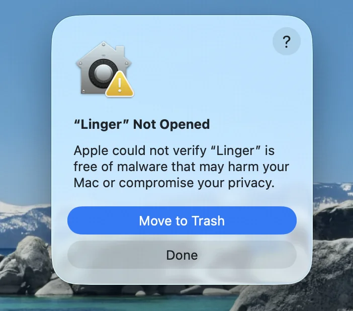
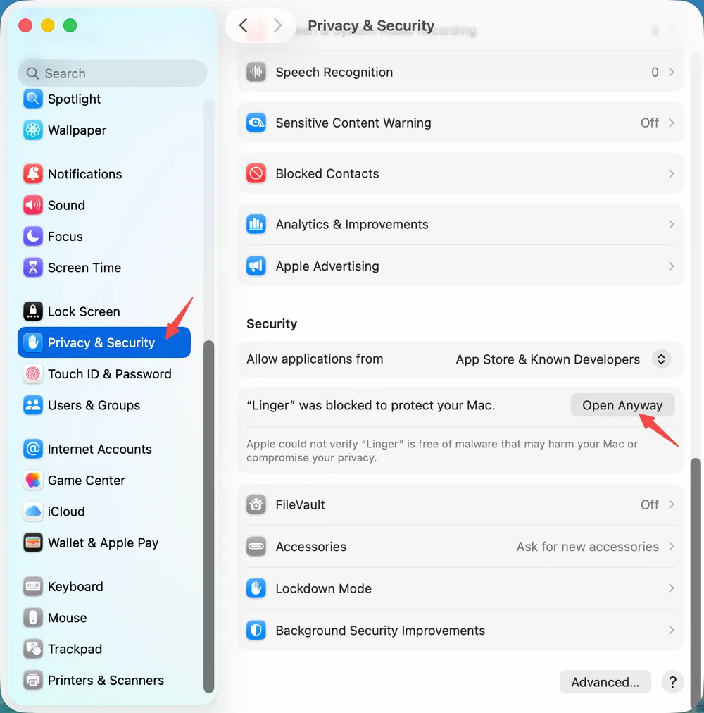

# Start Linger on macOS

We are applying for an Apple-recognized signing certificate. **Signed macOS
builds are coming soon.** The steps and screenshots below are a temporary
workaround for the current unsigned package.

You need an Apple silicon Mac running macOS 14.0 or later. There is no package
for Intel Macs; use [Docker Compose](self-hosting.md) there.

## Allow the first launch

[Download the DMG below](#download), open it and drag Linger to Applications.
The package is not yet signed with a certificate Apple recognizes, so macOS
blocks the first launch. Allow it once:

1. Open Linger from Applications. In the **“Linger” Not Opened** dialog, click
   **Done**. Do not click **Move to Trash**, the highlighted button.

   

2. Open **System Settings › Privacy & Security** and scroll to **Security**.
   Next to **“Linger” was blocked to protect your Mac**, click **Open Anyway**.

   

3. Click **Open Anyway** again and enter your password or use Touch ID.

If macOS says Linger "is damaged and can't be opened", or **Open Anyway** does
not appear, run this in Terminal and open Linger again:

```bash
xattr -dr com.apple.quarantine /Applications/Linger.app
```

## Download

**[Download the latest macOS release](https://github.com/simplexai-labs/linger/releases/latest)**

Under **Assets**, choose `Linger-<version>-macos-arm64.dmg` for Apple silicon.
Check the download against `SHA256SUMS.txt` from the same release.

See [Install the desktop app](https://docs.heylinger.com/install/desktop-app)
for help when setup fails.
