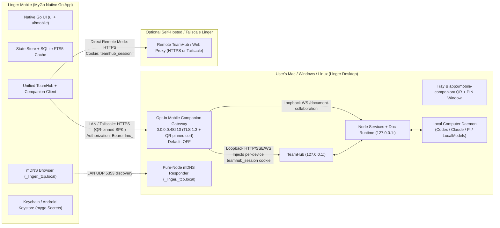

# Linger Mobile Companion: Product & Technical Architecture RFC

- **Status**: Implemented (All 5 Tabs, Desktop Companion Gateway, Cross-Stack E2E, Visual QA & CI Verified)
- **Target Directory**: `mobile/` (independent Go module at repository root)
- **Framework**: `github.com/egoist/mygo` pinned to `v0.10.1-0.20261123162213-5fe46f2dd0be` (latest `main` after `v0.10.0`)
- **Base Commit Audited**: `0e237c8c` (`oldwinter/linger-mobile`)
- **Upstream Sync Invariant**: `oldwinter/linger` syncs from `simplexai-labs/linger` every 5 hours. All mobile source lives under `mobile/`, and Desktop companion wiring is strictly additive and isolated inside `apps/desktop/` with zero edits to TeamHub, Web, Node Services, Local Computer Daemon, OpenAPI contracts, or shared root build manifests.

---

## 1. Repository Audit & Ground-Truth Linger Architecture

### 1.1 Runtime Topology in `oldwinter/linger`

Linger is a multi-service collaboration platform centered on Rooms. In both developer mode (`pnpm dev`) and Desktop Quick Install (`apps/desktop` driving `apps/linger-installer` and `packages/local-installation/src/native-source.ts`), five backend services run natively on loopback alongside the Local Computer Daemon:

| Component                   | Path                                                  | Language / Runtime       | Default Loopback Binding                                               | Responsibility                                                                                                                                                      |
| --------------------------- | ----------------------------------------------------- | ------------------------ | ---------------------------------------------------------------------- | ------------------------------------------------------------------------------------------------------------------------------------------------------------------- |
| **Web Static Host / Proxy** | `apps/web/static-host.mjs`, `apps/web/vite.config.ts` | Node / React + Vite      | `127.0.0.1:3000`, `::1:3000` (dynamic in Desktop native)               | Serves React SPA and reverse-proxies `/v0`, `/api/agent`, `/document-collaboration`, `/install`, `/v1/runner-gateway`, `/v1/local-mcp-relay`, `/v1/context-content` |
| **TeamHub**                 | `apps/teamhub/` (`go 1.26.0`, `toolchain go1.26.5`)   | Go + Gin + River + pgx   | `127.0.0.1:8080` (dynamic in Desktop native)                           | Persistence & collaboration authority (PostgreSQL 17 + pgvector), Human HTTP/SSE (`/v0/*`), Agent CLI API (`/api/agent/*`), artifact storage                        |
| **Node Services**           | `apps/node-services/`                                 | Node / TypeScript        | `127.0.0.1:4319` (shared), `127.0.0.1:4321` (Document Runtime)         | Hosts `agent` (Runner Gateway WS `/v1/runner-gateway`), `memory`, `llm-wiki`, `voice` workers, and Hocuspocus/Yjs `document` runtime                                |
| **Desktop Shell**           | `apps/desktop/`                                       | Electron 44 + TypeScript | Loads `serverUrl` (local or remote); local `app://` shell windows      | Manages `LocalServerModule`, `EnrollmentModule`, `ComputerDaemonModule`, `QuickNoteModule`, `TrayModule`, `DesktopIpcModule`                                        |
| **Local Computer Daemon**   | `apps/computer/local-daemon/` (`go 1.26.0`)           | Go                       | Outbound WS to Runner Gateway                                          | Runs Codex / Claude Code / Pi / Antigravity runtimes, executes `localmodels` library actions & BYOK gateway (`Bifrost`), enforces workspace grants, bridges `herdr` |
| **PostgreSQL & LiveKit**    | Bundled by `packages/local-installation/`             | PostgreSQL 17 + LiveKit  | Loopback ports recorded in `~/.linger/instances/desktop/instance.json` | Durable relational + vector storage, `LISTEN/NOTIFY` realtime wakes, local WebRTC voice media                                                                       |

Key findings from auditing TeamHub and Desktop:

1. **Authentication (`apps/teamhub/internal/app/app.go`, `handlers_auth.go`)**:
   - Human API routes under `/v0/*` authenticate via `requireSession()` -> `optionalPrincipal()`, which reads a single `HttpOnly` cookie `teamhub_session` containing a 64-hex encoding of a 32-byte random token. PostgreSQL stores only its SHA-256 digest (`sessions`).
   - Sessions default to 30-day TTL (`DefaultSessionTTL`) with a 90-day ceiling (`SessionMaxLifetime`), renewed explicitly via `POST /v0/session` and revoked via `POST /v0/auth/logout`.
   - TeamHub CORS (`apps/teamhub/internal/app/cors.go`) reflects `WEB_PUBLIC_ORIGIN` and private/loopback origins, never wildcards, with `Access-Control-Allow-Credentials: true`.
2. **Realtime Transport (`apps/teamhub/internal/app/handlers_human_events.go`, `internal/realtime/invalidation.go`)**:
   - One multiplexed SSE endpoint: `GET /v0/events?room=<roomId>:<roomSeq>` (up to 50 room cursors per stream).
   - Emits three event types:
     - `room.event`: persisted, monotonically ordered `RoomEventEnvelope` (`room_seq`) covering 20 event types (`message.created`, `message.reactions.changed`, `message.thread_summary.updated`, `card.changed`, `agent_run.status_changed`, `work_item.changed`, `routine.changed`, `document.created`, `document.comment.changed`, `capture.session.changed`, `team_md.published`, room/member lifecycle).
     - `resource.invalidated`: identity-only hints for 10 resources (`room`, `directory`, `agents`, `another-me`, `computers`, `connections`, `work-items`, `document`, `document-access`, `local-models`).
     - `stream.resync`: `{reason: "connected" | "hints_lost"}` signaling when displayed hint-scoped resources must refetch.
     - Plus `SESSION_EXPIRED` when the session is revoked or expires, and `: heartbeat` comments every 15s (which also re-check room watermarks).
   - **Live agent execution streaming** uses `agent_run.status_changed` room events carrying `RoomRunStatus.event_ordinal`, paired with incremental fetches from `GET /v0/rooms/:roomId/runs/:runId/runtime-presentation-events?after=<ordinal>` returning 7 structured presentation events (`status.changed` working/stopped, `plan.updated`, `activity.started`, `activity.updated`, `activity.finished`, `presentation.output_created`).
3. **Complete Public API Surface (`apps/teamhub/internal/app/routes_public.go`)**:
   - `routes_public.go` mounts **185+ public HTTP endpoints** covering Auth/Session/Account, Rooms/Direct Rooms/Threads/Messages/Attachments/Reactions/Pins/Forwarding/Participation/Read-State/Team-MD/History-Shares, Active Run Control/Background Tasks/Activities, 12 typed Decision/Approval Cards (`POST /v0/decisions/:decisionId` + screenshot), Agents/Availability/Skills/Templates/Another-Me, Local Computers/Permissions/Browser-Connection/Local-Models/Model-Source-BYOK, Work Items/Tasks/Comments/Timeline, Routines, Pocket Notes, Documents/Library/Versions/Comments/Link-Shares/Mail-Canvas, Personal Wiki/Graph, Personal Memory/Profile/Insights, Proactive Rules ("My Rules"), External Apps/Connections, Web Search Backends, and Voice Media Sessions/Captures/Transcripts/Provider Keys.
4. **Repository Gates & Constraints**:
   - **English-only gate** (`scripts/ci/check-changed-files.sh`): rejects CJK ideographs everywhere outside `apps/web/src/i18n/locales/` and `apps/desktop/src/i18n/locales/`. Mobile code, comments, tests, fixtures, and docs must be English-only (tests needing unspaced/non-ASCII text use escaped Unicode `\uXXXX`, kana, or emoji).
   - **Web JS bundle budget** (`apps/web/build-assets.mjs`): initial JS capped at 180 kB Brotli / 210 kB gzip / 1 MB minified. Avoiding `apps/web` edits keeps this budget untouched.
   - **Desktop i18n catalog check** (`apps/desktop/src/i18n/catalog.test.ts`): every `*.messages.ts` key must have a matching key in `apps/desktop/src/i18n/locales/zh-CN.json`.
   - **Env inventory check** (`scripts/check-env-inventory.ts`): scans `apps/*/src/**/*.ts`, `packages/*/src/**/*.ts`, `apps/teamhub/**/*.go`, `apps/computer/local-daemon/**/*.go`. Any new env var read in `apps/desktop/src/` must be documented or avoided in favor of `config.json` defaults.
   - **Check planner** (`scripts/check-plan.mjs`): `Makefile`, `scripts/check-plan.mjs`, `pnpm-workspace.yaml`, `package.json`, `.github/` are in `EVERYTHING_PATHS`.

### 1.2 Directory Placement Decision: `mobile/` at Repository Root

We place the entire mobile Go application under `mobile/` rather than `apps/mobile/`:

| Criterion                        | `mobile/` (Selected)                                                                                                                                                  | `apps/mobile/` (Rejected)                                                                                   |
| -------------------------------- | --------------------------------------------------------------------------------------------------------------------------------------------------------------------- | ----------------------------------------------------------------------------------------------------------- |
| `pnpm-workspace.yaml` (`apps/*`) | Completely outside workspace glob; zero pnpm scanning                                                                                                                 | Inside `apps/*` glob scanned by pnpm and `scripts/check-plan.mjs`                                           |
| Go Toolchain Isolation           | Separate `mobile/go.mod` (`go 1.27.3`) never collides with `apps/teamhub` (`go 1.26.0` / `go1.26.5`) or `apps/computer/local-daemon` (`go 1.26.0`)                    | Places Go 1.27 module beside Go 1.26 modules under `apps/`                                                  |
| Upstream Sync Conflicts          | Zero chance of collision if upstream adds `apps/mobile`; zero edits to root `Makefile` or `scripts/check-plan.mjs`                                                    | Risk of direct path collision; `AGENTS.md` convention pulls edits into root `Makefile` (`EVERYTHING_PATHS`) |
| Env Inventory & ESLint           | Outside `apps/*/src/**` scanner; checked by `prettier`, `check-doc-links.mjs`, English-only gate, and dedicated `mobile/Makefile` + `.github/workflows/mobile-ci.yml` | Subject to `apps/*` assumptions in future upstream scripts                                                  |

---

## 2. System Topology & Connection / Security Architecture

### 2.1 Dual Connection Modes

Linger Mobile supports two first-class connection transports through a single unified client interface (`mobile/internal/api`), allowing users to connect to both Electron Desktop hosts and headless/self-hosted servers:



1. **Desktop Companion Mode (Primary LAN & Tailscale-to-Desktop Flow)**:
   - User enables **Mobile Companion** in Linger Desktop (Tray -> `Mobile Companion…` -> isolated `app://mobile-companion/` window). **Default is OFF**; existing loopback-only posture for `web`, `teamhub`, `node-services`, `postgres`, and `livekit` is 100% preserved.
   - Desktop's `MobileCompanionModule` starts a dedicated reverse-proxy gateway (`companion/gateway.ts`) on port `48210` (configurable; falls back to an ephemeral free port if occupied), advertises `_linger._tcp.local` over mDNS when `advertiseMdns` is enabled, and generates a per-host self-signed ECDSA P-256 TLS certificate stored in `<userData>/companion/tls-cert.pem` + `tls-key.pem` (`0600`).
   - Mobile connects over **LAN Wi-Fi** (zero-config mDNS, QR scan, 6-digit PIN, or manual IP:port) OR over **Tailscale** (`https://<machine>.<tailnet>.ts.net:48210` or `100.x.y.z:48210` or Tailscale Serve HTTPS URL) using the exact same paired device bearer token.
   - Because Desktop hosts the Local Computer Daemon, local models (`localmodels` + Bifrost), and native services, Mobile automatically inherits **all of Desktop's runtimes, local models, workspace grants, connected apps, and PostgreSQL state** with zero duplication.
2. **Direct TeamHub Mode (Headless / Cloud / `pnpm dev` / Tailscale Remote URL)**:
   - Users running Linger via `docker compose`, cloud deployment, or `pnpm dev` without Desktop can enter any `https://` (or local/Tailscale `http://`) Linger origin directly.
   - Mobile signs in via `POST /v0/auth/login`, stores the `teamhub_session` cookie token in `mygo.Secrets`, sends `Cookie: teamhub_session=<hex>` on all REST and `/v0/events` SSE requests, and renews via `POST /v0/session` on foreground activation.
   - For developer `pnpm dev` workflows that want to test the full Pairing/mDNS/Companion experience without launching Electron, `apps/desktop/src/main/companion/standalone.ts` runs the identical gateway core directly against `TEAMHUB_BASE_URL` and `TEAMHUB_DOCUMENT_RUNTIME_URL`.

### 2.2 Pairing Handshake, Device Tokens & Credential Isolation

Pairing uses an explicit, time-bounded ceremony initiated only on Desktop:

1. **Opening a Pairing Window**:
   - Clicking **Pair New Device** in Desktop's `app://mobile-companion/` window generates:
     - `pair_id`: 128-bit random ID.
     - `pair_secret`: 256-bit random base64url secret (embedded in QR / deep link).
     - `pin`: 6-digit numeric code (`crypto.randomInt(0, 1_000_000)`, zero-padded) for manual entry without a camera.
     - `expires_at`: `now + 5 minutes`, single-use.
   - Desktop advertises `_linger._tcp.local.` over mDNS with TXT keys `v=1`, `host_id`, `name`, `tls=1|0`, `fp`, `pair=1|0`.
   - Desktop renders an offline SVG QR code (`companion/qr.ts`, zero npm deps) encoding:
     ```text
     linger://pair?v=1&host=<lan-ip>&port=48210&tls=<1|0>&fp=<tls_fingerprint>&code=<pair_secret>&name=<url-encoded-host>[&ts=<tailscale-ip>]
     ```
     where `tls_fingerprint` (`fp`) is the unpadded base64url encoding of `sha256(SubjectPublicKeyInfo DER)` (43 chars), and the human-verifiable short fingerprint is the first 16 uppercase hex characters of the decoded SHA-256 digest formatted as `XXXX-XXXX-XXXX-XXXX`.
2. **Completing Pairing (`POST /companion/v1/pair`)**:
   - Mobile scans the QR code (via `plugins/camera` or paste/deep link `linger://pair?...`) or selects an mDNS-discovered host and enters the 6-digit PIN.
   - Mobile verifies the server's TLS certificate SPKI SHA-256 fingerprint against `fp` from the QR (or displays the short `XXXX-XXXX-XXXX-XXXX` fingerprint for visual confirmation on manual PIN entry — TOFU pinning).
   - Mobile posts `{ code?, pin?, device_name, platform, app_version }`.
   - Desktop verifies `code` or `pin` using `crypto.timingSafeEqual`, enforces a strict **5 failed attempts lockout** (destroying the active pairing window immediately on lockout), and consumes the pairing window atomically.
   - **Per-Device TeamHub Session Minting**:
     - When Desktop serves its own `LocalServer`, the Companion Gateway calls `localServer.account()` once in memory and executes `POST http://127.0.0.1:<teamhub_port>/v0/auth/login` to obtain a **fresh, dedicated `teamhub_session` cookie** specifically for this paired mobile device.
     - When Desktop points at a remote server (no `local-account.json`), the Companion Gateway binds to Desktop's active web session cookie (marked `session_mode: "delegated"` in the device list) or invites Mobile to sign in directly to that remote URL.
     - Desktop generates a 256-bit device bearer token (`lmc_<base64url(32 bytes)>`), stores ONLY `sha256(token)` in `<userData>/companion/devices.json` (`0600`) and the device's dedicated `teamhub_session` in `<userData>/companion/device-sessions.json` (`0600`), and returns `{ device_id, token, host_id, host_name, tls_fingerprint, tenant_id, api_version, session_mode }` over the TLS channel.
   - **Never leaked to Mobile or LAN**: Desktop's local owner password, `local-account.json`, `local-identity.key`, `computer/credential.json`, and raw `teamhub_session` cookies never cross the wire in Companion Mode.
3. **Token Lifecycle (Rotation & Revocation)**:
   - **Rotation**: Mobile can rotate its token via `POST /companion/v1/token/rotate` (authenticated with current token); Desktop atomically replaces the stored SHA-256 hash and issues a new `lmc_` token.
   - **Revocation**: Revoking a device in Desktop's `app://mobile-companion/` window (or calling `POST /companion/v1/unpair` from Mobile) immediately removes the token hash, closes any active SSE/WS connections bound to that `device_id`, and calls `POST /v0/auth/logout` on TeamHub with that device's dedicated `teamhub_session` cookie so the backend session is dead in PostgreSQL too.

### 2.3 Companion Gateway Endpoints & Proxy Rules

| Path                                                                        | Auth Required                          | Behavior                                                                                                                                                                                                                                                                                                                                                                                         |
| --------------------------------------------------------------------------- | -------------------------------------- | ------------------------------------------------------------------------------------------------------------------------------------------------------------------------------------------------------------------------------------------------------------------------------------------------------------------------------------------------------------------------------------------------ |
| `GET /companion/v1/info`                                                    | None (minimal non-sensitive metadata)  | Returns `{ protocol_version: 1, host_id, host_name, desktop_version, pairing_open: bool, tls: bool, tls_fingerprint, addresses: { lan[], tailscale[] } }`. Zero user/tenant/room data.                                                                                                                                                                                                           |
| `POST /companion/v1/pair`                                                   | Active pairing `code` or 6-digit `pin` | Single-use 5-min window, max 5 failures per window + per-IP rate limit. Mints `lmc_<token>` and per-device TeamHub session.                                                                                                                                                                                                                                                                      |
| `GET /companion/v1/status`                                                  | `Bearer lmc_<token>`                   | Returns Desktop live summary: `host_id`, `host_name`, `desktop_version`, `computer_id`, `daemon_connection`, `runtime_state`, `active_operations`, `prevent_sleep`, `local_server_phase`, `local_models_degraded`, `server_url_mode` (`local` / `remote`), `device_id`, `paired_devices_count`.                                                                                                  |
| `POST /companion/v1/token/rotate`                                           | `Bearer lmc_<token>`                   | Rotates caller's bearer token atomically and returns `{ device_id, token }`.                                                                                                                                                                                                                                                                                                                     |
| `POST /companion/v1/unpair`                                                 | `Bearer lmc_<token>`                   | Self-revokes caller's device token, logs out its TeamHub session, and returns `{ unpaired: true }`.                                                                                                                                                                                                                                                                                              |
| `/v0/*` (HTTP + SSE `/v0/events`)                                           | `Bearer lmc_<token>`                   | Reverse-proxied to TeamHub (`127.0.0.1:<teamhub_port>` or Desktop's `serverUrl`). Strips client `Cookie`, injects device's dedicated `teamhub_session`, strips `Set-Cookie` from responses except updating the stored cookie on `POST /v0/session`. **Explicitly denies** `/v0/local/identity`, `/v0/auth/login`, `/v0/auth/logout`, `/v0/account/password`, `/v0/local-computer-enrollments/*`. |
| `/document-collaboration/*` (WS)                                            | `Bearer lmc_<token>`                   | WebSocket upgrade reverse-proxied to Document Runtime (`127.0.0.1:<document_port>`).                                                                                                                                                                                                                                                                                                             |
| All other paths (`/install/*`, `/v1/*`, `/api/agent/*`, `/internal/*`, `/`) | Denied (`404`)                         | Never exposed on LAN.                                                                                                                                                                                                                                                                                                                                                                            |

### 2.4 Security Threat Model & Mitigations

| Threat                                                  | Mitigation                                                                                                                                                                                                                                                                                                                         |
| ------------------------------------------------------- | ---------------------------------------------------------------------------------------------------------------------------------------------------------------------------------------------------------------------------------------------------------------------------------------------------------------------------------- |
| **Unauthorized LAN access by default**                  | Companion Gateway is disabled (`enabled: false`) by default; all core Linger services stay bound to `127.0.0.1`.                                                                                                                                                                                                                   |
| **Browser CSRF / LAN-pivoting from malicious websites** | Gateway rejects every request containing a browser `Origin` or `Sec-Fetch-Site: cross-site` header (native Go `net/http` client sends neither). Pairing and all APIs require `Bearer` tokens, never ambient browser cookies.                                                                                                       |
| **DNS Rebinding**                                       | Gateway strictly validates the `Host` header against local interface IPs, `localhost`, `<hostname>.local`, Tailscale CGNAT/MagicDNS hosts, or user-configured custom hostnames; rejects unexpected `Host` headers with `403`.                                                                                                      |
| **LAN Passive Sniffing / MITM on shared Wi-Fi**         | Gateway serves TLS 1.3 with a per-host ECDSA P-256 certificate whose SPKI SHA-256 fingerprint is pinned in Mobile via the QR code (or verified on PIN pairing). Plaintext `http://` is allowed only when the user explicitly opts in (e.g., over Tailscale WireGuard or local dev) and displays a clear transport badge in the UI. |
| **Brute-forcing 6-digit PIN**                           | Pairing window is closed by default, expires after 5 minutes, allows at most 5 total failed attempts across all IPs before auto-canceling the window, and applies constant-time comparison.                                                                                                                                        |
| **Token leakage in logs or diagnostics**                | Tokens are hashed with SHA-256 before disk storage (`0600`), never logged, and `devices.json`, `device-sessions.json`, and `tls-key.pem` are added to `apps/desktop/src/main/diagnostics.ts` secret exclusions.                                                                                                                    |
| **Device theft**                                        | Mobile stores all tokens and session credentials in OS hardware-backed `mygo.Secrets` (iOS Keychain / Android Keystore), supports optional Biometric App Lock (`plugins/biometrics`), and Desktop supports instant one-click per-device revocation.                                                                                |

### 2.5 Exact Minimal Upstream File Touch List

To keep 5-hour upstream syncs from `simplexai-labs/linger` nearly conflict-free, **zero files** are modified in `apps/teamhub/`, `apps/web/`, `apps/node-services/`, `apps/computer/`, `packages/`, `contracts/`, root `Makefile`, `pnpm-workspace.yaml`, `scripts/check-plan.mjs`, or `.github/workflows/ci.yml`.

**Existing upstream files modified (7 minimal additive hooks, all inside `apps/desktop/`):**

1. `apps/desktop/src/main/config.ts` — add optional `mobileCompanion` config schema block (`enabled: false` default, `port: 48210`, `advertiseMdns: true`, `tls: true`, `customHost?: string`).
2. `apps/desktop/src/main/index.ts` — instantiate and register `MobileCompanionModule` in `modules[]` passing `localServer`, `status`, `daemon`, `power`, `webSessionCookie`, and `userData`.
3. `apps/desktop/src/main/tray-menu.ts` — add `"mobile-companion"` to `TrayAction` and one menu item in `trayMenu()`.
4. `apps/desktop/src/main/tray.ts` — add `"MobileCompanion"` to `dependsOn` and handle `"mobile-companion"` by calling `show()`.
5. `apps/desktop/src/main/tray.messages.ts` & `apps/desktop/src/i18n/locales/zh-CN.json` — add 1 localized tray key (`mobileCompanion`) to satisfy `catalog.test.ts`.
6. `apps/desktop/src/main/diagnostics.ts` — add `"devices.json"`, `"device-sessions.json"`, and `"tls-key.pem"` to the excluded credential file list.
7. `apps/desktop/build.mjs` — add one esbuild preload target for `src/preload/mobile-companion.ts` -> `dist/preload/mobile-companion.cjs`.

**New isolated files added inside `apps/desktop/` (zero merge conflicts with upstream):**

- `apps/desktop/src/main/companion/gateway.ts` + `gateway.test.ts` (pure Node HTTP/HTTPS/SSE/WS proxy core)
- `apps/desktop/src/main/companion/pairing.ts` + `pairing.test.ts` (pairing window, PIN/secret verification, SHA-256 device registry)
- `apps/desktop/src/main/companion/mdns.ts` + `mdns.test.ts` (zero-dependency Node `dgram` RFC 6762/6763 `_linger._tcp.local` responder)
- `apps/desktop/src/main/companion/tls.ts` + `tls.test.ts` (zero-dependency Node `crypto` self-signed ECDSA P-256 X.509 cert + SPKI fingerprint generator)
- `apps/desktop/src/main/companion/qr.ts` + `qr.test.ts` (zero-dependency QR matrix -> SVG generator)
- `apps/desktop/src/main/companion/standalone.ts` (CLI runner for `pnpm dev` without Electron)
- `apps/desktop/src/main/mobile-companion.ts` + `mobile-companion.test.ts` (Electron `Module` + `app://mobile-companion/` window)
- `apps/desktop/src/shared/mobile-companion.ts`, `apps/desktop/src/preload/mobile-companion.ts`, `apps/desktop/src/shell/mobile-companion.html`

**New isolated files added at repo root:**

- `mobile/**` (complete MyGo native mobile application, tests, golden snapshots, `mygo.json`, `mobile/Makefile`, docs)
- `.github/workflows/mobile-ci.yml` (additive CI workflow for Go tests, vet, desktop-preview build, and iOS/Android CI build validation)

---

## 3. Mobile App Architecture (MyGo Native Go UI)

### 3.1 Verified `egoist/mygo` Toolchain & Version Pinning

Empirical spike verification on this macOS `darwin/arm64` host (with mise-managed `go1.27.2` and `GOTOOLCHAIN=local` by default):

- **Latest release tag**: `v0.10.0` (`ebde9399baf2734b3361856a53f4036859973d1d`, 2026-11-17).
- **Latest `main` commit**: `5fe46f2dd0befd83f99a15e2315028f25422ac4b` (2026-11-23), Go pseudo-version **`v0.10.1-0.20261123162213-5fe46f2dd0be`**.
- **Version Recommendation**: Pin **`github.com/egoist/mygo v0.10.1-0.20261123162213-5fe46f2dd0be`** rather than `v0.10.0`.
  - **Trade-off**: `v0.10.0` is a clean semver tag, but `main` contains 50+ high-value mobile & UI fixes landed after `v0.10.0` that directly affect our app:
    - `#2252` (`5fe46f2d`): hide phone edit menu once its input disappears.
    - `#2243` (`7e5c5ae7`): fix `plugins/imagepicker` camera launch on Android 11+.
    - `#2221` (`ef0b2517`): redraw Android surface cleanly on EGL resize / orientation change.
    - `#2235` (`dc99135e`): setting `ScrollState` offset stops `ScrollTo` (critical for chat auto-scroll).
    - `#2214` / `#2210`: allow on-screen keyboard to move selection in `ui/editor` and `ui/richtext`.
    - `#2164` (`3f787aca`): fix text ellipsis overflow at zero/narrow mobile widths.
    - `#2242` / `#2246` / `#2247`: dialog Escape/Back handling and overlay focus restoration.
    - `#2193`: GitHub-style tagfilter escaping in `ui/markdown`.
  - Both `v0.10.0` and `v0.10.1-0.20261123162213-5fe46f2dd0be` resolve cleanly through `GOPROXY=https://goproxy.cn,direct` and `proxy.golang.org`. Once `v0.10.1` is tagged upstream, bumping is a single `go.mod` line.
- **Reproducible Go Toolchain Invocation**:
  - `mygo` declares `go 1.27.3` in its `go.mod`. Because this machine's mise shim has `go 1.27.2` with `GOTOOLCHAIN=local`, every command in `mobile/Makefile` and CI sets **`GOTOOLCHAIN=auto`** (which automatically fetches and caches `go1.27.3`/`go1.27.4` with zero manual system edits).
  - Verified commands (all passed in our `/tmp` spike):
    - `GOTOOLCHAIN=auto go test -v ./...` -> `ui.Tester` (`SetInsets`, `FingerDown`/`FingerUp`, `golden.Match` across 320px/390px/420px) passed in `0.08s`; `plugins/sqlite` FTS5 passed in `1.26s` using MyGo's prebuilt native `sqlitecore` with **no cgo and no Zig**.
    - `GOTOOLCHAIN=auto CGO_ENABLED=0 go build -tags e2e -o bin/linger-mobile-preview .` -> 20 MB debug binary with `plugins/automation` enabled.
    - `GOTOOLCHAIN=auto CGO_ENABLED=0 go build -trimpath -tags mygo_noinspector -ldflags "-s -w -X github.com/egoist/mygo.production=1" -o bin/linger-mobile .` -> 13 MB stripped release binary.
    - Live macOS `420x800` phone-window verification via `MYGO_AUTOMATION=/tmp/linger-mobile.sock` succeeded: RPC `windows`, `tree`, `act`, `idle`, and `capture` produced an `840x1536` Retina PNG (`61,775` bytes) with zero Xcode or Android SDK installed locally.

### 3.2 Native Go UI vs. Embedded `ui.WebView` Boundary

We build **100% of the mobile product interface in MyGo Native Go UI** (`ui`, `ui/mobile`, `ui/markdown`, `ui/editor`, `ui/netimage`), avoiding a WebView SPA wrapper:

- **Why Native Go UI**:
  - Instant cold launch, single ~13 MB binary, GPU-rendered Metal (iOS/macOS) and OpenGL ES (Android), low memory footprint, native safe-area & keyboard handling, deterministic `ui.Tester` + `ui/golden` unit/visual testing without a browser engine, and direct Go access to SSE streams, mDNS sockets, TLS SPKI pinning, and SQLite FTS5 without JS bridge serialization overhead.
- **MyGo Packages & Plugins Used**:
  - **Core & Mobile UI**: `ui`, `ui/mobile` (`TopBar`, `BottomBar`, `Sheet`, `ActionSheet`, `Drawer`, `SwipeRow`, `ListRow`, `Section`, `Switch`, `Wheel`, `DatePicker`, `TimePicker`, `PageView`, `PageDots`, `Zoomable`, `FloatingButton`), `ui/markdown` (`markdown.View`, `markdown.Stream` with live reveal), `ui/editor` (`editor.DiffView` for runtime permission patches & code diffs, read-only code viewer), `ui/netimage` (memory + disk cached authenticated avatars & decision screenshots).
  - **Device & Storage Plugins**: `plugins/sqlite` (local offline cache + FTS5 search), `plugins/preferences` (non-secret UI settings, host metadata, last room/tab), `plugins/biometrics` (Face ID / Touch ID / Android BiometricPrompt app lock, graceful `ErrUnsupported` fallback on desktop preview), `plugins/imagepicker` (photo/media attachment picker), `plugins/camera` (QR pairing scanner + photo capture), `plugins/automation` (gated under `//go:build e2e` for live desktop-preview visual QA and automated UI journeys), `mygo.Secrets` (Keychain/Keystore for bearer tokens & cookies), `mygo.Haptics` (tactile feedback on approvals, sends, swipes, errors), `mygo.KeepState` (state survival across OS background eviction & `mygo dev` reloads), `mygo.Share` (native share sheet for documents, links, diagnostics), `mygo.Network` (online/metered status driving SSE reconnect & offline banner).
- **Strict, Narrow Exception for `ui.WebView`**:
  - Embedded `ui.WebView` is used **only** as an opt-in, sandboxed viewer leaf for two inherently HTML payloads that TeamHub serves:
    1. `html_fragment` inline message widgets (`HtmlFragmentSegment.html` from `show_fragment`), rendered only inside a sandboxed sheet/card preview.
    2. Signed Document HTML previews (`/v0/document-previews/:token/*`) for complex non-Markdown artifacts (HTML/PDF fallback when native preview isn't applicable).
  - All navigation, chat, streaming, cards, models, work items, routines, pocket notes, wiki, memory, and settings remain 100% Native Go UI.

### 3.3 Go Package Layout (`mobile/`)

```text
mobile/
├── go.mod                          # module github.com/oldwinter/linger/mobile (go 1.27.3)
├── go.sum
├── mygo.json                       # iOS + Android + macOS preview configuration
├── Makefile                        # test, vet, golden, preview, e2e-capture, check
├── docs/
│   └── ARCHITECTURE.md             # This RFC
├── resources/
│   ├── icon.png                    # 1024x1024 Linger icon (synced from apps/assets/logo)
│   └── icon-foreground.png         # Android adaptive icon foreground
├── cmd/
│   └── linger-mobile/
│       ├── main.go                 # App bootstrap, KeepState, OnOpenURL (linger://pair), Window setup
│       └── automation_e2e.go       # //go:build e2e -> import _ ".../plugins/automation"
└── internal/
    ├── config/                     # Multi-host profile schema, preferences persistence, secrets store adapter
    ├── discovery/                  # Pure-Go LAN mDNS browser (_linger._tcp.local) + linger://pair URI parser
    ├── api/                        # HTTP client (Companion Bearer + Direct Cookie), TLS SPKI pinning, typed DTOs
    ├── realtime/                   # Single /v0/events SSE engine, cursor replay, backoff, resync & run-status tracker
    ├── cache/                      # plugins/sqlite schema migrations, offline cache, Pocket Note outbox, FTS5 search
    ├── state/                      # Observable application store, optimistic mutations, error/loading state machines
    ├── theme/                      # Town Light & Town Dark ui.Theme tokens, typography scale, custom Painter icons
    ├── components/                 # Reusable mobile widgets (cards, status pills, avatar mosaic, composer, empty states)
    ├── screens/
    │   ├── connect/                # Connection Hub, mDNS radar, QR/PIN pairing, direct remote login, diagnostics
    │   ├── rooms/                  # Room list, Catch-up, Chat timeline, Threads, Live Run Watch, Decision Cards, Room Inspector
    │   ├── live/                   # Active Runs Monitor, Pending Approvals Inbox, Agents & Skills, Computers & Local Models/BYOK
    │   ├── work/                   # Work Items (Issues/Tasks) board & detail, Routines manager, Pocket Notes
    │   ├── library/                # Documents tree & reader/comments, Personal Wiki & Graph, Memory & Meetings, Global Search
    │   └── settings/               # Proactive Rules (My Rules), Profile/Insights, Connected Apps/Search/Voice Keys, Lock & Prefs
    └── testutil/                   # Fake TeamHub + Companion HTTP/SSE server, ui.Tester helpers, viewport & inset fixtures
```

### 3.4 Town Design System Mapping (Light & Dark Mobile Themes)

Every color, radius, and typographic role in `mobile/internal/theme` derives directly from Linger Web's Town tokens in `apps/web/src/app/visual-theme.css` and `apps/web/src/app/globals.css`:

| Semantic Role                 | Linger Web Token                                                                                                        | Mobile Town Light (`ui.Theme`)                                       | Mobile Town Dark (`ui.Theme`)        |
| ----------------------------- | ----------------------------------------------------------------------------------------------------------------------- | -------------------------------------------------------------------- | ------------------------------------ |
| Window Canvas                 | `--town-background: 60 20% 99%`                                                                                         | `#FDFDFB`                                                            | `#141412`                            |
| Card / Input Surface          | `--town-card: 0 0% 100%`                                                                                                | `#FFFFFF`                                                            | `#1D1D1A`                            |
| Sidebar / Bar / Muted Surface | `--town-sidebar: 75 23% 96.5%` / `--town-muted: 60 16% 95%`                                                             | `#F6F7F2` / `#F4F4EE`                                                | `#242420` / `#2A2A25`                |
| Primary Ink / Action          | `--town-foreground: 60 8% 9.4%` / `--town-primary`                                                                      | `#1A1A16` (text on action `#FFFFFF`)                                 | `#F5F5F0` (text on action `#141412`) |
| Muted / Metadata Text         | `--town-muted-foreground: 55 6% 42.5%`                                                                                  | `#737166`                                                            | `#A09E93`                            |
| Border / Divider              | `--town-border: 72 9% 92%`                                                                                              | `#ECECE7`                                                            | `#2F2F2A`                            |
| Info / Link / Mention         | `--town-info: 207 92% 42%`                                                                                              | `#0976CE`                                                            | `#4DA6F5`                            |
| Destructive / Unread Badge    | `--town-destructive: 14 89% 41%`                                                                                        | `#C6390B`                                                            | `#EF6238`                            |
| Success / Online              | `--town-success: 98 48% 35%`                                                                                            | `#4B842E`                                                            | `#6BB347`                            |
| Warning / Busy                | `--town-warning: 37 100% 39%`                                                                                           | `#C77B00`                                                            | `#F0A324`                            |
| Chat Own Bubble               | `--chat-own-bubble-bg: var(--app-ink)`                                                                                  | `#1A1A16` (text `#FFFFFF`)                                           | `#EAEAE3` (text `#141412`)           |
| Chat Agent Bubble             | `--chat-agent-bubble-bg: hsl(var(--town-muted) / 0.7)`                                                                  | `#F4F4EE`                                                            | `#242420`                            |
| Nature File/Entity Accents    | `sun #d95b31`, `rain #4e9ba2`, `lake #509578`, `grass #5e9662`, `lavender #a17cb9`, `acorn #b88022`, `bluebell #698cc7` | Identical semantic file-type & wiki entity chips                     | Luminance-lifted dark equivalents    |
| Radii & Typography            | `--radius-lg: 8px`, `--app-card-radius: 12px`, `--composer-radius: 16px`, body 14–15px, meta 12–13px                    | `Radius: 8`, Card `12`, Composer `16`, Touch min target `44x44` DIPs | Same metrics                         |

### 3.5 Offline SQLite + FTS5 Cache & Realtime Sync Engine

1. **Realtime Stream (`internal/realtime`)**:
   - Mirrors `apps/web/src/features/teamhub/event-transport.ts` and `run-status-transport.ts` in pure Go:
     - Opens one `GET /v0/events` SSE connection carrying `room=<id>:<last_seq>` for currently active/pinned rooms (up to 50).
     - Enforces contiguous `room_seq` ordering; on sequence gap or `stream.resync`, cleanly fetches missed events via `GET /v0/rooms/:roomId/events?after=<seq>` and refetches displayed hint-scoped resources.
     - Exponential backoff (`1s -> 30s` with jitter) paused when `mygo.Network.Status().Online == false` or app suspends (`Power.OnSuspend`), and immediately resumed on network restore or `App.OnActivate`.
     - Subscribes to `agent_run.status_changed` to trigger incremental `GET /v0/rooms/:roomId/runs/:runId/runtime-presentation-events?after=<ordinal>` pulls so live agent tool calls, plans, and streaming outputs update in real time with minimal bandwidth.
2. **SQLite Cache (`internal/cache`, backed by `plugins/sqlite`)**:
   - Stored per host profile (`<PathUserData>/cache/<host_id>.db`) so switching Desktop hosts never mixes spaces or leaks cross-host data.
   - Tables: `rooms`, `messages`, `actors`, `work_items`, `routines`, `pocket_notes`, `documents`, `local_models_snapshot`, `outbox_queue` (for offline Pocket Note edits and retryable messages), plus `search_fts` (`CREATE VIRTUAL TABLE search_fts USING fts5(kind, entity_id, room_id, title, body)`).
   - Cold launch hydrates the last screen from SQLite in <50 ms while SSE + REST reconcile live state in the background.

### 3.6 `mygo.json` & CI Buildability (iOS, Android, macOS Preview)

```json
{
  "name": "Linger Mobile",
  "slug": "linger-mobile",
  "identifier": "com.oldwinter.linger.mobile",
  "version": "0.1.0",
  "main": "./cmd/linger-mobile",
  "out": "build",
  "icon": "resources/icon.png",
  "urlSchemes": ["linger"],
  "ios": {
    "minimumSystemVersion": "17.0",
    "orientations": ["portrait", "landscape"],
    "launchScreen": { "background": "#FDFDFB", "image": "resources/icon.png" },
    "infoPlist": {
      "NSLocalNetworkUsageDescription": "Discover and connect to Linger Desktop on your local network.",
      "NSBonjourServices": ["_linger._tcp"],
      "NSCameraUsageDescription": "Scan Linger Desktop pairing QR codes and attach photos to Rooms.",
      "NSFaceIDUsageDescription": "Unlock Linger Mobile and confirm sensitive remote approvals."
    }
  },
  "android": {
    "minSdk": 26,
    "permissions": ["CAMERA", "CHANGE_WIFI_MULTICAST_STATE", "USE_BIOMETRIC"],
    "adaptiveIcon": {
      "foreground": "resources/icon-foreground.png",
      "background": "#FDFDFB"
    },
    "splash": "#FDFDFB"
  }
}
```

- **Local macOS Verification (no Xcode / Android SDK required)**:
  - `GOTOOLCHAIN=auto go test -race ./...`: runs Go unit tests, Companion/TeamHub mock protocol tests, SQLite FTS5 tests, `ui.Tester` touch/inset/narrow-viewport/accessibility tests, and `ui/golden` visual regression checks.
  - `GOTOOLCHAIN=auto CGO_ENABLED=0 go build -tags e2e ./cmd/linger-mobile`: builds a native macOS `420x800` phone-proportioned preview app with `plugins/automation` enabled so automated harnesses and agents can drive every screen against a real local Linger stack and capture real Retina PNG screenshots for visual QA.
- **GitHub Actions CI (`.github/workflows/mobile-ci.yml`)**:
  - `ubuntu-latest`: `go vet`, `go test -race ./...`, `CGO_ENABLED=0 go build` (linux + windows cross-checks).
  - `macos-latest` (has Xcode preinstalled): `go test ./...`, `mygo build -platform ios/simulator` (proving Swift host + plugins + Go cgo iOS arm64 link end-to-end).
  - `ubuntu-latest` (with Android SDK/NDK setup): `mygo build -platform android/arm64` (proving Kotlin host + SQLite CMake + Go Android arm64 `.apk` link end-to-end).

---

## 4. Complete Feature Matrix & Mobile Navigation IA

### 4.1 Five-Tab Phone Information Architecture

Designed around `ui/mobile.BottomBar` (5 clear destinations, each keeping its own `ui.Router` push stack and scroll state via keyed containers) + `mobile.TopBar` + `mobile.Sheet` / `mobile.ActionSheet` / `mobile.Drawer`:

| Tab            | Primary Focus                           | Push Stack & Sheets                                                                                                                                                                                                                                                                                                                                                                                                                                                                                                               | Real TeamHub / Companion Endpoints Wired                                                                                                                                                                                                                                                                                                                                                                                                                                                                                                                                                                                                                                                                         |
| -------------- | --------------------------------------- | --------------------------------------------------------------------------------------------------------------------------------------------------------------------------------------------------------------------------------------------------------------------------------------------------------------------------------------------------------------------------------------------------------------------------------------------------------------------------------------------------------------------------------- | ---------------------------------------------------------------------------------------------------------------------------------------------------------------------------------------------------------------------------------------------------------------------------------------------------------------------------------------------------------------------------------------------------------------------------------------------------------------------------------------------------------------------------------------------------------------------------------------------------------------------------------------------------------------------------------------------------------------- |
| **1. Rooms**   | Live Watch & Chat                       | Room List (`All`, `Unread`, `Working`, `Direct`, `Rooms`) -> **Room Chat** -> **Thread View**, **Live Run Watch** (plan + tool timeline + cancel/redeliver), **Decision Card Detail** (diff/screenshot/form), **Room Inspector Sheet** (Members/Roles, Pinned Messages, Room Docs, `team.md`, Room Routines, History Shares), **Catch-Up Walk**, **New Room / New DM Sheet**, **Attachment / Camera / Mention / Skill Pickers**                                                                                                   | `GET/POST /v0/tenants/:t/rooms`, `GET /v0/tenants/:t/another-me`, `GET /v0/tenants/:t/room-activity`, `GET/PATCH/DELETE /v0/rooms/:r`, `PUT /v0/rooms/:r/pin\|read-state\|participation`, `GET/POST /v0/rooms/:r/messages`, `POST .../thread\|forward`, `PUT/DELETE .../reactions/:id\|pin`, `GET .../pins`, `POST/DELETE .../message-attachment-uploads`, `GET/PUT/DELETE .../members/:a`, `GET .../run-statuses`, `GET .../runs/:run/runtime-presentation-events\|activities`, `POST .../runs/:run/cancel\|redeliver-unconfirmed-inputs`, `GET/POST .../background-tasks`, `POST /v0/decisions/:id`, `GET /v0/decisions/:id/screenshot`, `GET/POST /v0/documents/:d/mail`, `GET .../team-md`, `GET /v0/events` |
| **2. Live**    | Agent Runtime, Approvals & Local Models | Segmented top switcher: **Active Runs** (live working/failed runs across all rooms, watch & stop), **Approvals** (all pending decision cards across rooms with 1-tap Approve/Deny + haptics), **Agents** (availability, status, edit model/reasoning/instructions, toggle skills, create/delete agent, open DM), **Compute** (Enrolled Computers, permissions/browser status, **Local Models** GPU/RAM pools, download progress/ETA, load/Make-Room/unload/remove/recheck, **Model Source & BYOK** switcher + test + list models) | `GET /v0/tenants/:t/room-activity`, `GET/POST/PATCH/DELETE /v0/tenants/:t/agents`, `GET /v0/tenants/:t/agent-availability`, `GET/PUT/DELETE .../agents/:a/skill-bindings/:s`, `GET /v0/tenants/:t/skill-manifests`, `GET /v0/tenants/:t/agent-templates`, `GET/DELETE /v0/tenants/:t/local-computers`, `GET/POST .../local-models`, `POST .../local-models/:m/actions`, `GET/POST .../model-source`, `POST .../model-source/test\|models`, `GET/POST .../permissions`, `GET/PUT/DELETE .../browser-connection`, `POST .../skill-scans`, `GET /companion/v1/status`                                                                                                                                               |
| **3. Work**    | Issues, Routines & Pocket Notes         | Segmented top switcher: **Issues & Tasks** (`Mine`, `Open`, `In Progress`, `Resolved`; create issue, priority, transitions, assignees, comments, timeline, task execution view, jump to work room), **Routines** (cross-room + per-room schedules, create/edit cadence with native `DatePicker`/`TimePicker`/`Wheel`, toggle enabled `Switch`, Run Now), **Pocket Notes** (today's offline-resilient note with local SQLite outbox sync, past days reader, send to Another Me)                                                    | `GET/POST /v0/tenants/:t/work-items`, `GET/PATCH /v0/work-items/:id`, `POST .../transitions\|archive\|unarchive`, `PUT/DELETE .../assignments/:a`, `GET/POST/PATCH/DELETE .../comments`, `GET .../timeline`, `GET /v0/tasks/:id/execution\|conversation\|runtime-presentation-runs`, `GET/POST /v0/rooms/:r/routines`, `PATCH/DELETE /v0/routines/:id`, `POST .../run`, `GET/DELETE /v0/tenants/:t/me/pocket-notes`, `PUT .../today`                                                                                                                                                                                                                                                                             |
| **4. Library** | Docs, Wiki, Memory & Search             | Persistent search bar (instant SQLite FTS5 + live TeamHub message/document search) + segmented views: **Documents** (My Tree, Shared Tree, Room Docs, Markdown/Code/Image/WebView-preview reader, version history, comment threads + replies + resolve, upload file/photo, link share), **Wiki** (state, generation, trigger refresh, pages preview, zoomable knowledge graph), **Memory & Meetings** (daily/weekly journals, meeting transcripts, audio playback, Ask Meeting Q&A, stop/retry active capture)                    | `GET /v0/tenants/:t/messages/search`, `GET /v0/library/documents`, `GET /v0/library/documents/search`, `GET /v0/tenants/:t/me/document-tree\|shared-document-tree`, `GET/PATCH/DELETE /v0/documents/:d`, `GET .../downloads\|versions\|history\|comment-threads`, `POST .../comment-threads\|comments`, `GET/PUT/DELETE .../link-share`, `POST /v0/tenants/:t/documents\|uploads`, `GET /v0/tenants/:t/personal-wiki`, `POST .../refresh`, `GET .../preview\|documents\|graph`, `GET /v0/tenants/:t/memory`, `GET .../memory/:id`, `GET /v0/voice-captures/:c`, `GET/POST .../questions`, `POST .../stop\|transcript-recovery/retry`                                                                             |
| **5. More**    | Hosts, Rules, Integrations & App Prefs  | **Desktop Host Card & Switcher** (LAN mDNS / QR / PIN / Tailscale / Remote URL, live RTT, TLS pin fingerprint, SSE status, Diagnostics export via `mygo.Share`), **My Rules** (Proactive rules, shadow rule review & divergences, promote/edit/pin/mandate), **Profile & Insights**, **Connectors & Keys** (External Apps/Connections, Web Search backends & keys, Voice policy & provider keys), **Security & Preferences** (Biometric Lock, Town Light/Dark/System theme, Composer Enter mode, Cache & Sign-out)                | `GET /companion/v1/info\|status`, `POST /companion/v1/pair\|token/rotate\|unpair`, `POST /v0/auth/login\|logout`, `GET/POST /v0/session`, `GET /v0/me`, `GET/PATCH /v0/tenants/:t/account-profile`, `GET /v0/tenants/:t/me/proactive-rules`, `PATCH/DELETE/PUT/POST .../proactive-rules/:id`, `GET/POST /v0/tenants/:t/personal-profile`, `GET/DELETE .../personal-insights`, `GET /v0/external-apps\|external-connections`, `POST .../status-checks\|disconnects`, `PUT .../agent-grants/:a`, `GET/PUT/DELETE /v0/web-search/...`, `GET /v0/tenants/:t/voice-media-policy`, `PUT /v0/voice-provider-keys/:p`                                                                                                    |

### 4.2 Decision Card Coverage (All 12 Real Kinds)

Mobile treats approvals as a first-class remote operation workflow (both inline in Room Chat and aggregated in the Live -> Approvals inbox):

- `runtime_permission`: Displays tool name, judge rationale, command/JSON input, optional file patch via `editor.DiffView`, optional GUI screenshot via authenticated `netimage.Image` (`GET /v0/decisions/:id/screenshot`), and **Approve** / **Deny (with optional reason)** buttons with `mygo.Haptics.Success()` / `Warning()`.
- `connector_write`: Displays connected app/account, email/chat To/Cc/Bcc/Subject/Body or structured change fields, and **Send / Approve** vs **Don't send**.
- `question`: Renders every `DecisionQuestion` (`radio` single-select, `checkbox` multi-select, plus free-text custom answer input) and posts `decision: "submit"` with `answers`.
- `agent_change`: Shows create/update diffs of agent name, description, and prompt + Approve/Deny.
- `room_creation`, `connection_auth`, `provider_key`, `search_key`, `browser_connection`, `computer_permission`, `profile_setup_apps`, `profile_setup_sources`: Each renders its exact structured view fields and valid `DecisionRequest` actions (or links directly to the corresponding Mobile setting / key entry sheet).
- **Mail Canvas** (`GET/POST /v0/documents/:id/mail`, `POST .../mail/decline`): Renders email preview + Send / Send again / Don't send using the stored source digest.

### 4.3 Mobile UX Rigor Rules (Enforced by Automated Tests)

1. **Narrow-Screen Safety (`320px–430px`)**: Every screen, card, toolbar, segmented control, and composer is tested in `ui.Tester` at `320x640`, `390x844`, and `420x800` with zero horizontal clipping, zero overlapping hit targets, and `>= 44x44` DIP tap targets for all interactive controls.
2. **Safe-Area & Keyboard Insets**: All tests inject realistic mobile insets (`SetInsets(59, 0, 34, 0)` and keyboard-open `SetInsets(59, 0, 336, 0)`). Top bars respect top inset, bottom bars hide automatically above keyboards (`mobile.BottomBar` built-in `keyboardAtLeast = 120`), and chat composers dock cleanly above the software keyboard.
3. **CJK & IME Enter Discipline**: Chat/comment/search composers never submit while IME composition is active, support configurable Return-key behavior (`Return = Newline` default on phones with an explicit Send button; `Cmd/Ctrl+Enter` sends on hardware keyboards), and wrap CJK text without mid-character clipping.
4. **Explicit Stateful Labels & Zero Stale Error Banners**: Every network operation uses explicit status enums (`idle`, `loading`, `ready`, `refreshing`, `error`, `offline`) with clear text labels (`Connected`, `Catching up…`, `Reconnecting…`, `Offline — viewing cached data`, `Downloading 42% · 18.4 MB/s`, `Approving…`). Successful recovery or navigation clears prior transient error banners immediately — never leaving stale errors on screen.
5. **Actionable Empty States**: Every list (No Hosts, No Rooms, No Pending Approvals, No Local Models, No Work Items, No Search Matches) shows a concise explanation and a direct primary action button (e.g., `Pair Desktop`, `New Room`, `Refresh Library`, `Clear Filters`).
6. **Navigation & Scroll/Filter Restoration**: Keyed tab subtrees (`c.Key(tab)`) and `ui.Router` + `mygo.KeepState` preserve list scroll offsets, active filters, search queries, and unsent room drafts when pushing detail views, switching tabs, or returning from background.

---

## 5. Phased Implementation & Verification Plan

### Wave Breakdown

| Wave                                                            | Scope & Deliverables                                                                                                                                                                                                                                                                                                                                                                                                                                                           | Key Files                                                                                                                                       | Verification Gate                                                                                                                                                                                |
| --------------------------------------------------------------- | ------------------------------------------------------------------------------------------------------------------------------------------------------------------------------------------------------------------------------------------------------------------------------------------------------------------------------------------------------------------------------------------------------------------------------------------------------------------------------ | ----------------------------------------------------------------------------------------------------------------------------------------------- | ------------------------------------------------------------------------------------------------------------------------------------------------------------------------------------------------ |
| **Wave A: Desktop Companion Gateway & Pairing**                 | Implement pure-Node Companion Gateway (`gateway.ts`, `pairing.ts`, `mdns.ts`, `tls.ts`, `qr.ts`, `standalone.ts`), Electron `MobileCompanionModule` + `app://mobile-companion/` QR/PIN/Devices UI, and the 7 minimal wiring hooks in `apps/desktop/`.                                                                                                                                                                                                                          | `apps/desktop/src/main/companion/*`, `apps/desktop/src/main/mobile-companion.ts`, `apps/desktop/src/shell/mobile-companion.html`, 7 small hooks | `make check-desktop` (typecheck, eslint `--max-warnings=0`, vitest unit + integration tests including `catalog.test.ts`, CSRF/DNS-rebinding/PIN-lockout/TLS-pinning/revocation security tests)   |
| **Wave B: Mobile Core, Protocol, Cache & App Shell**            | Scaffold `mobile/` (`go.mod`, `mygo.json`, `Makefile`), unified TeamHub + Companion HTTP/TLS-pin client, `/v0/events` SSE + run-status engine, pure-Go mDNS browser, SQLite + FTS5 cache & outbox, Town Light/Dark theme, 5-tab shell, Connection Hub (mDNS + QR/PIN + Direct URL + Multi-host switcher).                                                                                                                                                                      | `mobile/internal/{config,discovery,api,realtime,cache,state,theme,components}`, `mobile/internal/screens/connect`, `mobile/cmd/linger-mobile`   | `GOTOOLCHAIN=auto go test -race ./...` (protocol tests, SSE replay/gap/resync tests, SQLite FTS5 tests, `ui.Tester` tests at 320/390/420px + insets)                                             |
| **Wave C: Full Feature Screens (100% Real APIs)**               | Build all 5 tabs and sub-stacks wired end-to-end to TeamHub & Companion APIs: Rooms + Threads + Live Run Watch + all 12 Decision Cards + Mail Canvas + Rich Composer; Live Ops + Pending Approvals + Agents/Skills + Computers + Local Models & BYOK; Work Items/Tasks + Routines + Offline Pocket Notes; Library Docs/Comments + Wiki/Graph + Memory/Meetings + Global Search; Settings + My Rules + Connectors/Search/Voice Keys + Biometric Lock + Diagnostics Share.       | `mobile/internal/screens/{rooms,live,work,library,settings}`                                                                                    | Per-feature `ui.Tester` interaction + accessibility + golden tests against fake TeamHub server (`internal/testutil`) covering happy paths, error/offline recovery, CJK/IME, and narrow viewports |
| **Wave D: Live Full-Stack E2E, Visual QA, Security Audit & CI** | Run real Linger backend + Companion Gateway + `linger-mobile` macOS `420x800` preview binary with `plugins/automation`; execute live E2E script covering Pairing -> Room Chat -> Live Agent Watch -> Decision Approval -> Local Models -> Work Items -> Pocket Note -> Search; capture & visually inspect Retina PNG screenshots of every major screen in Light & Dark themes; adversarial security/race review; add `.github/workflows/mobile-ci.yml` and `mobile/README.md`. | `mobile/internal/e2e/`, `.github/workflows/mobile-ci.yml`, `mobile/README.md`                                                                   | Full live E2E green, screenshot audit zero visual defects, `GOTOOLCHAIN=auto go test -race ./...`, `make check BASE=main`, `make check-repository-gate BASE=main`                                |

### Open Architecture Calls for Coordinator Review Before Wave A

1. **TLS Mode Default on LAN**: This RFC defaults Desktop Companion Gateway to **TLS 1.3 with a per-host self-signed ECDSA P-256 cert pinned via QR SPKI fingerprint** (preventing bearer token sniffing on shared Wi-Fi), with an explicit toggle/fallback for plain HTTP over Tailscale/dev. Confirm this default is desired.
2. **Pairing UI Location**: This RFC puts the Desktop pairing UI inside an isolated Desktop shell window (`app://mobile-companion/`, opened from the system tray, identical to `QuickNoteModule`), keeping **0 edits in `apps/web`**. Confirm we should NOT add a duplicate pairing page inside `apps/web` Settings (which would touch `apps/web` routes, i18n, and risk upstream sync conflicts).
3. **Voice Audio Scope**: Mobile fully supports inspecting Voice Media policy, saving/checking Soniox/xAI provider keys, viewing active captures & live transcripts (`GET /v0/voice-sessions/:id/events/stream`), stopping/retrying captures, asking meeting Q&A, and playing back recorded meetings. Full bidirectional WebRTC LiveKit microphone streaming on iOS/Android would require a native LiveKit SDK plugin (Swift/Kotlin); confirm deferring live mic WebRTC to a post-v1 native module while shipping full transcript/capture/meeting/key control in v1.
